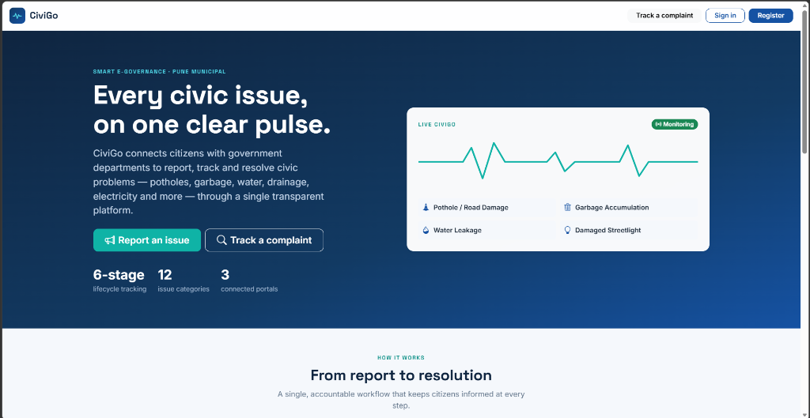
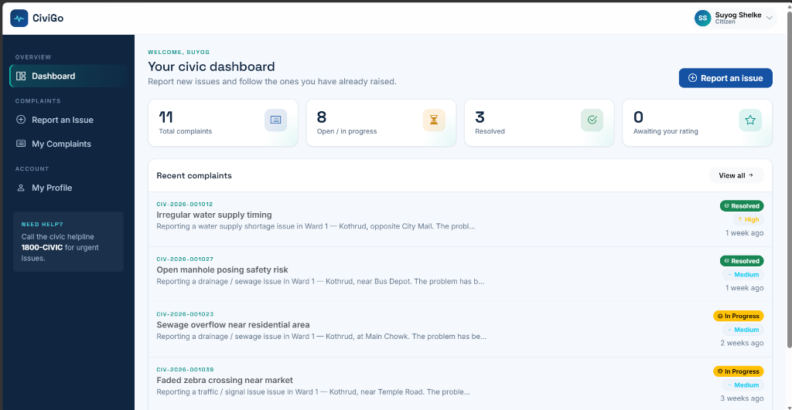
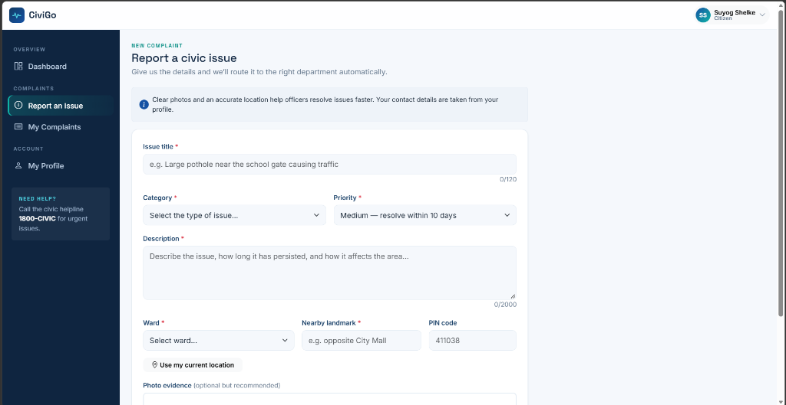
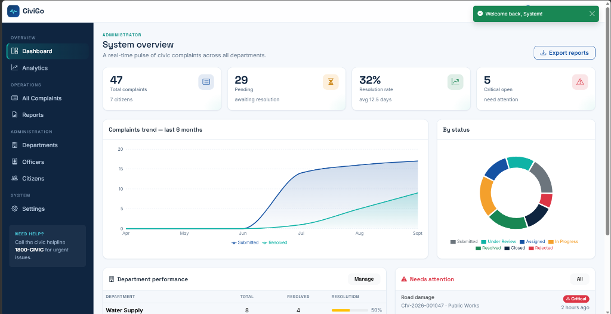
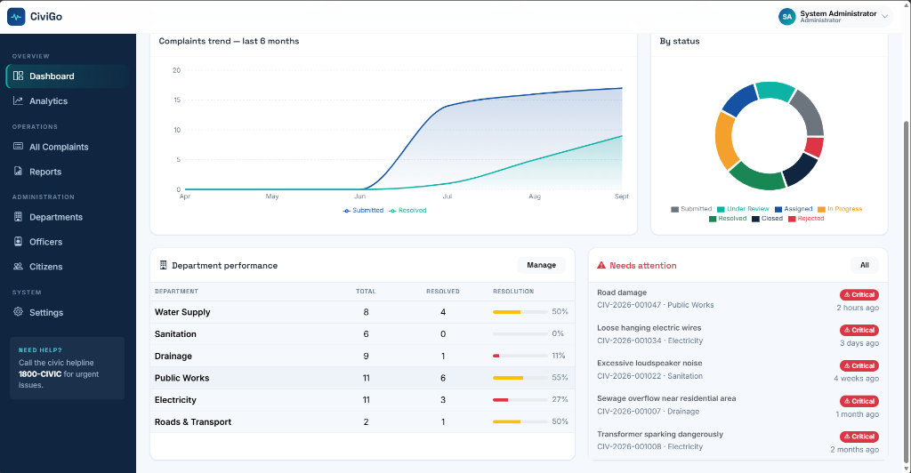

# CiviGo 🚀

CiviGo is a modern civic engagement platform designed to bridge the gap between citizens and local authorities. It empowers users to report civic issues, track them to resolution, and provides administrators and officers with the tools they need to manage and resolve complaints efficiently.

## 🌟 Features

### For Citizens
* **Easy Reporting**: Report issues like potholes, streetlights, or sanitation with just a few clicks.
* **Real-time Tracking**: Monitor the status of your complaints (Submitted, Assigned, In Progress, Resolved).
* **Feedback System**: Provide feedback and ratings on resolved issues.
* **Email Verification**: Secure authentication and account verification powered by Firebase.

### For Officers & Administrators
* **Role-based Dashboards**: Dedicated views for Officers to see assigned complaints and for Admins to see platform analytics.
* **Status Management**: Move complaints through the resolution pipeline.
* **Analytics**: Beautiful charts to track resolution times, complaint categories, and officer performance.

## 🛠 Tech Stack

* **Frontend**: React (Vite), Bootstrap 5, Recharts for analytics, React Router.
* **Backend**: Django (Python), Django REST Framework.
* **Authentication**: Firebase Authentication (JWT Verification).
* **Hosting**: Firebase Hosting (Frontend).

## 🚀 Getting Started

### Prerequisites
* Node.js (v18+)
* Python (3.10+)

### Local Development

1. **Clone the repository**
   ```bash
   git clone https://github.com/suyogshelke/Civi-Go.git
   cd Civi-Go
   ```

2. **Run the Frontend**
   ```bash
   cd frontend
   npm install
   npm run dev
   ```

3. **Run the Backend**
   ```bash
   cd backend
   python -m venv venv
   venv\Scripts\activate
### Deployment Process (Firebase Hosting)

The frontend is fully configured for easy deployment to Firebase Hosting.

1. **Install Firebase CLI**
   ```bash
   npm install -g firebase-tools
   ```

2. **Login to Firebase**
   ```bash
   firebase login
   ```

3. **Build & Deploy**
   ```bash
   cd frontend
   npm run build
   npx firebase-tools deploy --only hosting
   ```
   *Your live app will be accessible at: https://civicgo-cdd73-22dae.web.app*

## 📸 Screenshots

**Landing Page**
<br>


**Citizen Dashboard**
<br>


**Reporting a Civic Issue**
<br>


**Administrator Analytics Dashboard**
<br>


**Officer Dashboard**
<br>


## 📄 License
This project is licensed under the MIT License.
